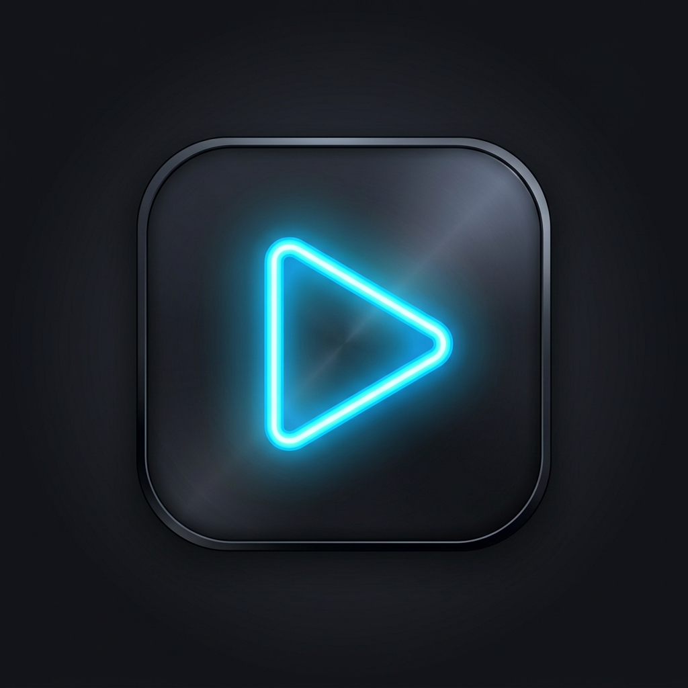

# Scroll — Minimalist Local Video Feed Player

<p align="center">
  
</p>

<p align="center">
  <strong>Your local video library, reimagined as a distraction-free vertical feed.</strong>
</p>

<p align="center">
  
  
  
  
  
</p>

---

## 📖 Overview

**Scroll** is a modern, performance-focused mobile application built with Flutter that transforms your device's offline video collection into a seamless, TikTok/Reels-style vertical scroll feed. 

No algorithms, no ads, no recommendations, and no distractions — just your own videos with intelligent shuffling, background sound playback, continuous touch acceleration, and intuitive gesture controls.

---

## ✨ Key Features

1. **Infinite Vertical Feed**:
   - Strict 1-video-per-page vertical snap physics with swipe navigation.
   - Smooth transitions and zero stutter between video transitions.

2. **Background Audio Playback (User Configurable)**:
   - Toggle background audio in settings to keep sound playing even when your screen is locked or the app is minimized.

3. **Screen Rotation On-Demand**:
   - Easily rotate between portrait and landscape modes with a dedicated button on the player overlay, dynamically adapting layout and video aspect ratio.

4. **Continuous Touch & Hold Speed-Up (Facebook / TikTok Style)**:
   - Touch and hold anywhere on the screen during playback to accelerate video speed (customizable from 1.25x to 3.0x, default 2.0x).
   - Accompanied by tactile haptic feedback and a dynamic speed badge. Release to instantly resume normal playback speed.

5. **Smart Random Shuffled Queue**:
   - Shuffles videos randomly while strictly guaranteeing that videos played in the last **20 to 25 items** are not repeated.
   - Full history tracking allows swiping back up through previously watched videos seamlessly.

6. **Favorites Playlist**:
   - One-tap Heart button on the video player overlay to mark videos as favorites.
   - Dedicated filter to stream only your favorited videos, with easy tap-to-exit banner navigation.

7. **Direct Video Upload & Folder Scanning**:
   - Select individual video files directly from device storage via the settings dashboard.
   - Scan multiple directories recursively for standard video formats (`.mp4`, `.mkv`, `.mov`, `.webm`, `.3gp`, `.avi`).

8. **Gesture & Playback Controls**:
   - **Single-tap**: Pause / Resume video.
   - **Double-tap**: Instant mute / unmute toggle with animated flash overlays.
   - **Speed selector**: Fine-tune default speed from 0.5x to 2.0x.
   - **Auto-Scroll**: Choose between looping the active video or automatically advancing when playback completes.

9. **Physical File Management & Sharing**:
   - Safely delete unwanted videos permanently from disk directly from the feed (with confirmation prompt).
   - Share videos directly to external messaging apps and social media via native system share dialogs.

10. **Memory & Battery Optimized (Sliding Window)**:
    - Maintains an active sliding window of only **3 video controllers** in memory (`[index - 1, index, index + 1]`).
    - Distant controllers are immediately paused and disposed to eliminate memory leaks and crashes.
    - Minimal rebuilds through fine-grained `ValueListenableBuilder` progress indicators.

---

## 🛠️ Architecture & Project Structure

```
scroll/
├── android/                   # Native Android configuration & Gradle files
├── assets/
│   └── logo.png               # High-resolution application brand logo
├── ios/                       # Native iOS project & Info.plist configuration
├── lib/
│   ├── main.dart              # App entry point, feed view, and lifecycle management
│   ├── models/
│   │   └── video_queue_manager.dart # Intelligent non-repeating queue & history tracking
│   ├── services/
│   │   └── storage_service.dart     # Storage scanning, permissions & SharedPreferences
│   └── widgets/
│       ├── settings_sheet.dart      # Glassmorphic settings & source configuration sheet
│       └── video_player_widget.dart # Custom video player with gesture & overlay controls
├── test/
│   └── widget_test.dart       # Unit & widget smoke tests
├── pubspec.yaml               # Flutter package dependencies and versioning
└── README.md
```

---

## 🛡️ Platform Permissions

### 🤖 Android Setup (`android/app/src/main/AndroidManifest.xml`)

Scroll supports Scoped Storage on Android 10+ and 11+ (API 30+) using media permissions and `MANAGE_EXTERNAL_STORAGE` for custom directory traversal:

```xml
<manifest xmlns:android="http://schemas.android.com/apk/res/android">
    <!-- Storage & Media Permissions -->
    <uses-permission android:name="android.permission.READ_EXTERNAL_STORAGE" android:maxSdkVersion="32" />
    <uses-permission android:name="android.permission.WRITE_EXTERNAL_STORAGE" android:maxSdkVersion="32" />
    <uses-permission android:name="android.permission.READ_MEDIA_VIDEO" />
    <uses-permission android:name="android.permission.MANAGE_EXTERNAL_STORAGE" />

    <application
        android:label="scroll"
        android:name="${applicationName}"
        android:icon="@mipmap/ic_launcher"
        android:requestLegacyExternalStorage="true">
        ...
```

### 🍎 iOS Setup (`ios/Runner/Info.plist`)

```xml
<key>NSPhotoLibraryUsageDescription</key>
<string>This app requires access to your photo library to select and scan folders/files containing videos.</string>
<key>NSAppleMusicUsageDescription</key>
<string>This app requires access to your media library to scan for media and video assets.</string>
<key>UISupportsDocumentBrowser</key>
<true/>
<key>LSSupportsOpeningDocumentsInPlace</key>
<true/>
```

---

## 🚀 Getting Started

### Prerequisites

- [Flutter SDK](https://docs.flutter.dev/get-started/install) (`^3.9.2` or later recommended)
- [Dart SDK](https://dart.dev/get-dart)
- Android Studio / VS Code with Flutter extension
- Connected Android/iOS device or emulator

### Installation & Run

1. **Clone the repository**:
   ```bash
   git clone https://github.com/your-username/scroll.git
   cd scroll
   ```

2. **Install dependencies**:
   ```bash
   flutter pub get
   ```

3. **Run the project**:
   ```bash
   flutter run
   ```

4. **Run Unit and Widget Tests**:
   ```bash
   flutter test
   ```

5. **Build Release APK**:
   ```bash
   flutter build apk --release
   ```
   The compiled APK will be output to:
   `build/app/outputs/flutter-apk/app-release.apk`

---

## 📦 Pushing to GitHub

To publish this project to your GitHub account:

```bash
# 1. Initialize git repository (if not already done)
git init

# 2. Stage all project files
git add .

# 3. Create your initial commit
git commit -m "feat: Scroll v2.0.0 - Local video feed with background audio, smart queue, and touch speed-up"

# 4. Set default branch to main
git branch -M main

# 5. Link your remote GitHub repository
git remote add origin https://github.com/<your-username>/<your-repo-name>.git

# 6. Push code to GitHub
git push -u origin main
```

---

## 📄 License

This project is licensed under the [MIT License](LICENSE).
